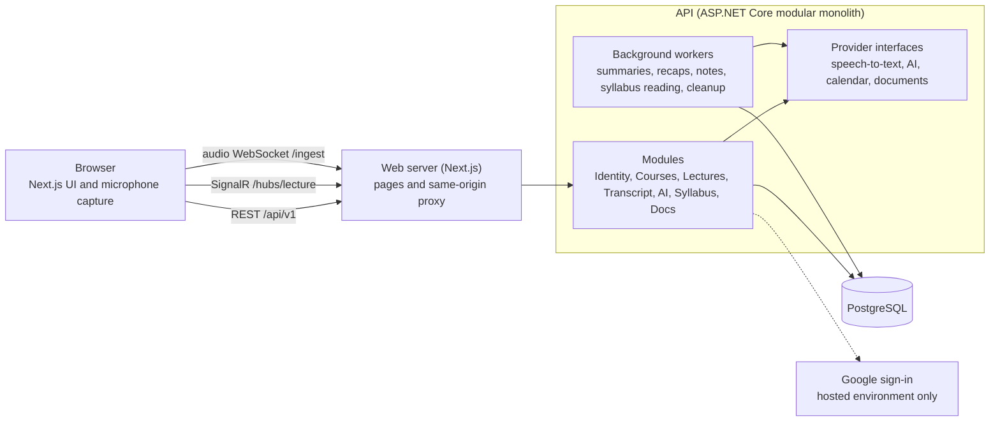

# Tether

Tether is a neurodivergent-friendly academic assistant for college students. It turns a lecture into a live transcript, a TL;DR that keeps itself up to date, a one-click **Quick recap** of the last few minutes, and notes that link back to the moment each point was said. It also reads a syllabus, proposes the dates it found, and adds them to a calendar only after the student has reviewed and approved them. The interface is designed to be calm: nothing pops up, nothing nags, and the student starts every action.

## Contents

- [Project status](#project-status)
- [Features](#features)
- [How it works](#how-it-works)
- [Tech stack](#tech-stack)
- [Repository layout](#repository-layout)
- [Getting started](#getting-started)
- [Configuration and providers](#configuration-and-providers)
- [Deployment](#deployment)
- [Security and privacy](#security-and-privacy)
- [Accessibility](#accessibility)
- [Quality and CI](#quality-and-ci)
- [Roadmap](#roadmap)
- [Documentation](#documentation)
- [Contributing and working with Claude Code](#contributing-and-working-with-claude-code)
- [License](#license)

## Project status

The lecture slice and the syllabus slice are built end to end: web app, API, database, realtime transport, tests and CI. The repository deploys Tether to Azure as an invite-only environment (see [Deployment](#deployment)).

Read these four points before relying on anything below:

- **Demo providers everywhere.** In every environment, including the hosted one, the transcript, the AI output, the calendar and the exported document come from built-in demo providers. The transcript is a fixed test script paced by audio timing, not what the microphone hears. Summaries, recaps and notes come from a mock AI client. Calendar entries go to a "Demo calendar" and exported notes go to a "Demo Doc", both stored in Tether's own database. Nothing is sent to an AI vendor, a speech vendor, Google Docs or Google Calendar. No real provider adapter is built yet, and the API refuses to start with any other provider setting.
- **Google is used for sign-in only.** Local development uses a development login instead.
- **Account-wide export and delete are designed, not built.** A student can delete a lecture, a syllabus or a course today, download one lecture's notes and download one syllabus. "Download all my data" and "delete my account" are specified in [docs/architecture/account-export-delete.md](docs/architecture/account-export-delete.md) (ADR-021, proposed) and have no code yet.
- **Release gates.** What Tether is cleared to be used for is recorded in the gate register, [docs/RELEASE_GATES.md](docs/RELEASE_GATES.md). That register is the source of truth, not this README.

## Features

Everything in this section exists in the code under `src/web` and `src/api`. Planned work is under [Roadmap](#roadmap).

### Lectures

- **Consent before capture.** A lecture session starts only after an explicit consent step. Recording status is always visible, and Pause, Resume and Stop are one click away.
- **Live transcript.** Lines stream in as partial text, settle as final lines and can be corrected afterwards.
- **Continuously updated TL;DR.** A short summary of the lecture so far, revised as the lecture goes on.
- **Quick recap.** One click summarizes the last 2, 5 or 10 minutes. Tether remembers the window the student usually picks.
- **Notes with source timestamps.** After Stop, "Make notes" produces structured notes. Each point carries a time that jumps to the transcript line it came from.
- **Finished lectures stay readable.** Reopen a lecture later to read its transcript, summary and notes.
- **Safe failure states.** A denied or missing microphone leads to a clear screen, not a silent failure. A lost connection shows a banner, retries, and pauses recording if it lasts. Sessions left unattended pause and then stop on their own.
- **Focus mode.** On wide screens the student can strip the lecture screen down to the essentials. It is never turned on automatically.

### Notes and export

- Copy the notes, or download them as a Markdown file. This happens in the browser.
- Export notes to a document with a preview first and a deliberate confirm. When the notes have changed, the student chooses between updating the earlier document and creating a new one.

### Syllabus and planning

- Add a syllabus by pasting its text or uploading a plain-text file.
- Tether proposes the items it found, each with the source wording it came from. A date Tether is not sure of stays marked as needing a date. Dates it noticed but did not turn into items are listed separately so nothing is quietly dropped.
- The student approves, skips or edits each item, one at a time or in a batch, and can add items by hand.
- Only approved items can be added to the calendar. Adding is idempotent, so repeating it creates no duplicates, and an item can be removed again.
- Download a copy of a syllabus and its items as JSON, or delete it.

### Courses and navigation

- Sign in, create and edit courses, and see a "Today" dashboard that suggests one next step.
- A command palette for keyboard navigation and look settings. It never starts or stops a recording.
- Delete a single lecture or a whole course with its content.

### Calm, accessible design

- **Quiet by default.** No unsolicited popups, sounds or nudges. Screen-reader announcements of new transcript lines and TL;DR changes are opt-in.
- **Look preferences.** Five themes, light, dark or system color mode, a low-stimulation look, text size, reading spacing, density and reduced motion. A theme changes paint only; layout, words and controls stay the same.
- **No surveillance.** Tether does not track attention and does not diagnose anyone.
- **Plain language.** Student-facing text follows a written language guide and is checked by an automated copy lint.

## How it works



- **Web app.** A Next.js application. The browser talks only to the web server, which forwards `/api`, `/hubs` and `/ingest` to the API. Session cookies and origin checks therefore work on a single origin.
- **API.** One ASP.NET Core process split into modules. Each module owns its database schema and migrations, and architecture tests keep module internals private.
- **Realtime.** The browser captures microphone audio as 16 kHz PCM and sends it over a WebSocket opened with a short-lived, single-use ticket. Transcript lines, summary revisions and recap results come back over a SignalR hub as versioned `lecture.v1` events. After a dropped connection the client rejoins and catches up from the last event it saw.
- **Data.** PostgreSQL through EF Core. Source transcripts are stored apart from derived summaries, recaps and notes, and derived content keeps its provenance. Raw audio is held in memory only and is not written to disk.
- **Providers.** Speech-to-text, AI, calendar and document export each sit behind an interface, so a real provider can replace a demo one without changing the modules that use it.
- **Background work.** Hosted services inside the API produce summaries, recaps and notes, read syllabi, end unattended sessions and remove expired data. Audio ingest never waits on AI work.
- **Contracts.** Wire formats are JSON Schemas in `src/shared/contracts` (`lecture.v1`, `syllabus.v1`, `docs.export.v1`, `auth.v1`, and a draft `calendar.v1`). Tests on both the API and the web side validate against the same files.

More detail: [docs/ARCHITECTURE.md](docs/ARCHITECTURE.md), [docs/architecture/](docs/architecture/) and [docs/DECISIONS.md](docs/DECISIONS.md).

## Tech stack

| Layer | Technology |
|---|---|
| Web | Next.js 15, React 19, TypeScript, Tailwind CSS |
| API | ASP.NET Core on .NET 10 (C#), modular monolith |
| Data | PostgreSQL 16, EF Core with Npgsql, per-module migrations |
| Realtime | SignalR for events, a raw WebSocket for audio, AudioWorklet capture |
| Contracts | JSON Schema (draft 2020-12), validated with Ajv on the web and JsonSchema.Net in the .NET tests |
| Sign-in | Google sign-in (OpenID Connect with PKCE) in the hosted environment; a development login locally |
| Web tests | Vitest, Testing Library, Playwright, axe-core, MSW |
| API tests | xUnit: unit, contract, architecture and integration tests against PostgreSQL |
| Infrastructure | Docker and Docker Compose locally; Bicep, Azure Container Apps and Azure Database for PostgreSQL Flexible Server when hosted |
| CI and scanning | GitHub Actions, CodeQL, gitleaks, Trivy, npm and NuGet audits, Dependabot |

## Repository layout

```text
src/web/              Next.js web app, unit tests and Playwright suites (e2e, e2e-harness, e2e-screens)
src/api/              ASP.NET Core solution (Tether.slnx)
  src/Tether.Host/      composition root, middleware, rate limits, health checks
  src/Modules/          Identity, Courses, Lectures, Transcript, Ai, Syllabus, Docs
  src/Tether.DocReader/ DOCX text extractor (built, not yet wired into uploads)
  tests/                xUnit test projects
src/shared/contracts/ versioned JSON Schema contracts and fixtures
infra/                Bicep template, deploy check scripts, local rehearsal stack
scripts/              one-command local start, demo data seed, Azure setup scripts
docs/                 product, architecture, security, UX, AI, data, QA and operations documents
.github/              CI, CodeQL and deploy workflows, Dependabot configuration
.claude/              shared Claude Code settings (permission rules)
CLAUDE.md             project instructions for Claude Code
docker-compose*.yml   local stacks: development, container proof of concept, production rehearsal
```

## Getting started

Everything local runs on demo and synthetic data. No accounts, keys or paid services are needed.

### Prerequisites

- Docker Desktop, running
- Node.js 22 or newer
- Git

A .NET SDK on the host is optional. The API builds, runs and tests inside the `mcr.microsoft.com/dotnet/sdk:10.0` container.

### Run it

From the repository root:

```bash
node scripts/start-local.mjs          # any shell
.\scripts\start-local.ps1             # Windows PowerShell wrapper for the same script
```

The script starts PostgreSQL and the API with Docker Compose, starts the web server, seeds demo data and prints the address. The first run builds the API inside its container and can take several minutes. Then open <http://localhost:3000>.

```bash
node scripts/start-local.mjs status   # show what is up
node scripts/start-local.mjs stop     # stop the web server and the containers; data is kept
node scripts/start-local.mjs --seed   # seed the demo data again; safe to repeat
```

To start the parts by hand:

```bash
docker compose -f docker-compose.yml -f docker-compose.dev.yml up -d postgres api
cd src/web
npm ci
npm run dev:real
```

Run only one web dev server at a time. The full guide, including what the script will and will not do, is [docs/DEVELOPMENT.md](docs/DEVELOPMENT.md).

### Signing in locally

The local API runs in Development mode, which enables a development login: type any email address and you are signed in, with no password. Use `demo@dev.local` to see the seeded demo courses, a finished demo lecture and a demo syllabus waiting for review. The development login exists only in Development mode. Google sign-in is not needed locally.

### Other local stacks

| File | Purpose |
|---|---|
| `docker-compose.yml` + `docker-compose.dev.yml` | Everyday development: PostgreSQL, the API and a .NET tooling container |
| `docker-compose.poc.yml` | The two container images wired the way the hosted environment runs them, with the development login |
| `docker-compose.poc-prod.yml` | Production-mode rehearsal with no development login; see [infra/README.md](infra/README.md) |

### Run the tests

Web, from `src/web` (in Windows PowerShell use `npm.cmd`):

```bash
npm run typecheck
npm run lint
npm test
```

API, from the repository root. Stop the development API first; [docs/DEVELOPMENT.md](docs/DEVELOPMENT.md) explains why:

```bash
docker compose -f docker-compose.yml -f docker-compose.dev.yml stop api
docker compose -f docker-compose.yml -f docker-compose.dev.yml run --rm dotnet dotnet test src/api/Tether.slnx
docker compose -f docker-compose.yml -f docker-compose.dev.yml up -d api
```

Playwright end-to-end suites have rules about which configuration to use next to a running dev server. Follow [docs/DEVELOPMENT.md](docs/DEVELOPMENT.md) and [docs/ops/ci-matrix.md](docs/ops/ci-matrix.md) rather than running `npm run e2e` blindly.

## Configuration and providers

Every external capability sits behind an interface, and each has exactly one implementation today.

| Capability | Interface | Implementation today | Setting and accepted value |
|---|---|---|---|
| Speech-to-text | `ISpeechToTextProvider` | Replay demo source: a fixed script paced by audio timing | `Speech:Provider` = `replay` |
| AI: TL;DR, Quick recap, notes | `IAiClient` | Mock client | `Ai:Provider` = `mock` |
| Syllabus reading | `ISyllabusExtractor` | Rule-based mock extractor | `Syllabus:Extractor` = `mock` |
| Calendar | `ICalendarProvider` | Demo calendar, stored in Tether's database | `Syllabus:CalendarProvider` = `mock` |
| Document export | `IDocsProvider` | Demo Doc, stored in Tether's database | `Docs:Provider` = `demo_docs` |

- **No silent paid calls.** The API checks these settings at startup and refuses to start on any other value. A configuration change alone cannot switch on a real provider, because no real adapter exists yet.
- **Real providers need approval.** Adding one takes new code, a security review and explicit Product Owner approval of the vendor and its cost.
- **Budgets come first.** The AI module already carries per-session, per-user and global spend limits, and would refuse a real provider without an explicit key and explicit budgets.
- **Fault injection is test-only.** Demo scripts and injected failures are rejected outside Development and Test.
- **Secrets stay out of the repository.** Local Compose credentials are development-only defaults. Hosted secrets are supplied at deploy time.

API settings worth knowing are listed in [src/api/README.md](src/api/README.md).

## Deployment

The hosted environment is defined in [infra/main.bicep](infra/main.bicep) and deployed by [.github/workflows/deploy-azure-dev.yml](.github/workflows/deploy-azure-dev.yml).

- **Platform.** Azure Container Apps runs two containers. The web container is the only public entry. The API container is internal and always runs in Production mode. The database is Azure Database for PostgreSQL Flexible Server with TLS required.
- **Releases.** The workflow is started by hand. Every run waits for the Product Owner's approval before it touches Azure, and signs in with a short-lived federated identity rather than a stored Azure credential.
- **Sign-in.** Invite-only Google sign-in: an account must be on Tether's own invite list before anything is created for it. There is no development login in the hosted environment. See [ADR-022](docs/architecture/go-live-signin-adr.md).
- **Access modes.** Each run picks one: `team` puts a Microsoft sign-in gate in front of the site, `invited` relies on Google sign-in plus the invite list, and `closed` is the emergency stop that takes the site off the internet.
- **Fail closed.** After a deploy the workflow checks the site from outside. If a run that opens the site does not pass those checks, it closes the site again.

Steps, costs and known limits are in [infra/README.md](infra/README.md).

## Security and privacy

Tether is designed around these rules. They come from the architecture invariants in [CLAUDE.md](CLAUDE.md).

- **Your data is yours.** Every resource belongs to one user, and the server checks ownership on every request. Another user's item answers "not found".
- **Recording is explicit and reversible.** Capture starts only after consent, its status stays visible, and it can be paused or stopped at any time.
- **Audio is not kept.** Raw audio is processed in memory and is not stored.
- **Sources and summaries stay separate.** Transcripts and documents are stored apart from the summaries and notes derived from them, with timestamps and provenance.
- **AI is kept on a short leash.** AI components never receive sign-in tokens and cannot call external tools. AI output is validated against a schema and rendered as plain text.
- **Nothing is written without review.** Syllabus dates are proposals until the student approves them, uncertain dates stay uncertain, and calendar writes are idempotent.
- **Lecture content stays out of logs.** Application and database logging are configured to keep transcript and syllabus text out, and a CI check plants a marker to prove it.
- **Defense in depth.** Server-side sessions that can be revoked, origin checks on state-changing requests and on WebSocket upgrades, rate limits per user and per client address, security headers, and an API that is not reachable from the internet when hosted.
- **No credentials in code.** Secrets are never committed. CI scans the full history for them.

Requirements are in [docs/SECURITY.md](docs/SECURITY.md). Reviews, the findings register and the severity policy are in [docs/security/](docs/security/). These are internal engineering reviews, not an independent audit.

## Accessibility

Tether targets WCAG 2.2 AA.

- Keyboard access throughout, with a skip link and a predictable tab order.
- Recording status is announced to assistive technology and is never dimmed by a theme or the low-stimulation look.
- Device settings for reduced motion and color mode are respected, and the app adds its own controls for both.
- Playwright runs axe-core scans tagged for WCAG 2.2 AA on the main screens, at phone and desktop widths, across the themes. Separate checks cover layout geometry and reflow.

Automated checks do not replace testing with real assistive technology and real devices. The plan for that is [docs/qa/device-accessibility-plan.md](docs/qa/device-accessibility-plan.md), and its status is in the gate register.

## Quality and CI

[.github/workflows/ci.yml](.github/workflows/ci.yml) runs on every pull request and on every push to `main`. Documentation-only changes skip the heavy jobs.

| Job | What it does |
|---|---|
| `web` | Type check, ESLint, the copy and theme lint gate, Vitest unit tests, production build |
| `api` | Release build with warnings as errors, then every .NET test project against PostgreSQL, then a check that no row text reaches the database log |
| `e2e harness` | Playwright against the lecture UI harness, with no API |
| `e2e real stack` | Playwright against the real web app, API and database in four shards: user flows, screens with accessibility scans, and layout checks across themes |
| `secret scan` | gitleaks over the full git history |
| `dependency audit` | `npm audit` and the NuGet vulnerability check |
| `dependency review` | GitHub dependency review, on pull requests |
| `container and config scan` | Trivy, on pull requests |
| `infra scripts` | Case tests for the deploy checks and the emergency stop; the Bicep template must compile, lint and contain no dependency cycle |
| `ci result` | One aggregate check that fails if any required job failed |

[.github/workflows/codeql.yml](.github/workflows/codeql.yml) analyzes C# and TypeScript on pull requests, on pushes to `main` and weekly. Dependabot watches GitHub Actions, npm, NuGet and Docker Compose images. The job table and known limits are in [docs/ops/ci-matrix.md](docs/ops/ci-matrix.md).

## Roadmap

Not built yet, in rough order:

1. **Account-wide export and delete** ("download all my data", "delete my account"), designed in ADR-021.
2. **Real providers** behind the existing interfaces: streaming speech-to-text, Anthropic Claude for summaries, recaps and notes, and Google Docs and Google Calendar with least-privilege scopes. Each needs Product Owner approval and the relevant release gates.
3. **PDF and Word syllabus files.** The DOCX text extractor exists and is tested but is not connected to uploads. PDF reading is not started.
4. **Study tools:** contextual tutoring, editable study guides, practice-test import and adaptive quizzes, and calendar reminders.
5. **Later:** low-pressure executive-function coaching, concept tracking, spaced repetition, a knowledge map and selectable engagement modes.

The current state and history of the work are in [docs/PROGRESS.md](docs/PROGRESS.md). Where each milestone stands, and what comes next, is in [docs/DEVELOPMENT_ROADMAP.md](docs/DEVELOPMENT_ROADMAP.md). Product requirements are in [docs/PRODUCT_REQUIREMENTS.md](docs/PRODUCT_REQUIREMENTS.md).

## Documentation

| Topic | Where |
|---|---|
| Local development and testing | [docs/DEVELOPMENT.md](docs/DEVELOPMENT.md), [src/api/README.md](src/api/README.md) |
| Architecture overview and decisions | [docs/ARCHITECTURE.md](docs/ARCHITECTURE.md), [docs/DECISIONS.md](docs/DECISIONS.md), [docs/architecture/](docs/architecture/) |
| API and event contracts | [docs/API_CONTRACTS.md](docs/API_CONTRACTS.md) and the other `docs/API_CONTRACTS_*.md` files, [src/shared/contracts/](src/shared/contracts/) |
| Product requirements and backlog | [docs/PRODUCT_REQUIREMENTS.md](docs/PRODUCT_REQUIREMENTS.md), [docs/product/](docs/product/) |
| Progress log | [docs/PROGRESS.md](docs/PROGRESS.md) |
| Release gates | [docs/RELEASE_GATES.md](docs/RELEASE_GATES.md) |
| Security and privacy | [docs/SECURITY.md](docs/SECURITY.md), [docs/security/](docs/security/) |
| UX, language and themes | [docs/ux/](docs/ux/) |
| AI design | [docs/ai/](docs/ai/) |
| Data model | [docs/data/](docs/data/) |
| Testing and accessibility plans | [docs/qa/](docs/qa/) |
| Deployment and operations | [infra/README.md](infra/README.md), [docs/ops/](docs/ops/) |
| Vendor and legal research notes | [docs/vendors/](docs/vendors/), [docs/legal/](docs/legal/) |
| Agent team and playbook | [docs/agents/](docs/agents/) |

Design documents and reviews describe the project as it was when they were written. Where one disagrees with the code, the code and [docs/PROGRESS.md](docs/PROGRESS.md) are the better guide.

## Contributing and working with Claude Code

Tether is built with [Claude Code](https://claude.com/claude-code), directed by a human Product Owner who approves product tradeoffs, spending, external permissions and deployments.

- [CLAUDE.md](CLAUDE.md) holds the project instructions: mission, architecture invariants, team routing and the release gates. Claude Code loads it automatically when started from the repository root.
- `.claude/settings.json` holds shared permission rules. For example, it denies force-pushes, blanket `git add` and commands that change Azure resources.
- The agent team is defined at user level, not in this repository. Reference copies of the six agent definitions are in [docs/agents/shared-team/](docs/agents/shared-team/), and the working rules are in [docs/agents/project-playbook.md](docs/agents/project-playbook.md).
- Hard design and implementation work is done by two senior engineer agents as a pair: independent proposals, cross-critique, convergence, then one builds and the other reviews.

Ground rules for any change:

1. Keep to the architecture invariants and the versioned contracts. Change a contract before the code that depends on it.
2. Add or update tests, and run the relevant suites before opening a pull request. CI reports one aggregate check, `ci result (all required jobs)`.
3. Use demo or synthetic data only. Never commit secrets, real user data or lecture content.
4. Do not connect a real provider, spend money or deploy without the Product Owner's approval.

This is a small, owner-directed project and has no formal process for outside contributions yet.

## License

No license has been chosen yet.
